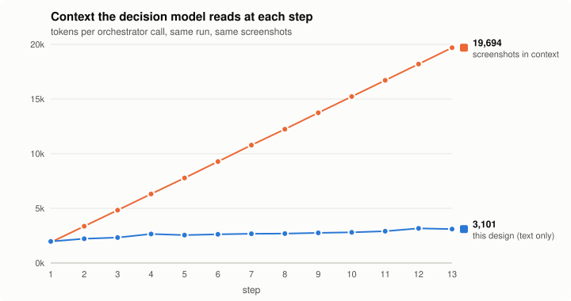
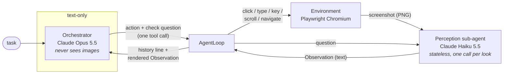

# glance

A browser-controlling agent whose decision-making model never sees a screenshot.

## The idea

A computer-use agent usually puts a fresh screenshot into the main model's context at every step. Over a long task the screenshots pile up: each one costs roughly 1,000–2,000 tokens, they are re-read on every later step, and cost, latency and attention quality all get worse as the task goes on.

This project separates **perception** from **decision**:

- **The perception sub-agent** (a vision model) is the only component that ever sees a raw screenshot. Each call is stateless: it gets one screenshot and one specific question, and returns a short text observation: a summary of the screen, the interactive elements that matter with their click coordinates, and a direct answer to the question. The screenshot is then discarded.
- **The orchestrator** (Claude) never sees an image. Its context is plain text: the task, a one-line-per-step action history, and the latest observation. It decides the next action.

Because screenshots live only inside one throwaway perception call, the orchestrator's context grows by one short history line per step (~100 tokens) instead of one full screenshot (~1,340 tokens plus wrapping), and nothing it has seen is ever re-read as an image.

## Results: context size over a 13-step task



The task (`scripts/long_task.py`): search Wikipedia for Alan Turing, scroll (no table of contents) to the school he attended at 13, then search for Ada Lovelace and read her father's name from the infobox. The agent finished in 13 steps with both answers correct (Sherborne School; George Byron, 6th Baron Byron).

- **This design** is measured: the input token count the API reported for each orchestrator call.
- **Baseline** is reconstructed exactly, not estimated. For each step, `scripts/analyze_trace.py` builds the transcript a conventional agent would carry: same system prompt, tools, task and actions, but with every screenshot from this run fed back as a tool result. It then counts that transcript with Anthropic's token-counting endpoint.

| step | action | this design: orchestrator context | baseline: screenshots in context | perception input (discarded after the call) |
|---:|---|---:|---:|---:|
| 1 | `navigate` | 1,971 | 1,894 | 2,034 |
| 2 | `click` | 2,221 | 3,362 | 2,035 |
| 3 | `type` | 2,329 | 4,835 | 2,053 |
| 4 | `key` | 2,652 | 6,310 | 2,039 |
| 5 | `scroll` | 2,548 | 7,773 | 2,055 |
| 6 | `scroll` | 2,624 | 9,278 | 2,052 |
| 7 | `look` | 2,672 | 10,780 | 2,054 |
| 8 | `scroll` | 2,688 | 12,238 | 2,051 |
| 9 | `click` | 2,754 | 13,741 | 2,035 |
| 10 | `type` | 2,804 | 15,225 | 2,047 |
| 11 | `key` | 2,907 | 16,708 | 2,062 |
| 12 | `scroll` | 3,169 | 18,199 | 2,045 |
| 13 | `done` | 3,101 | 19,694 | – |

What the numbers say:

- **Growth per step: ~94 tokens here vs ~1,480 for the baseline.** Each 1280×800 screenshot costs 1,337 tokens (measured with the token-counting endpoint), plus about 150 for the tool call and result around it, and the baseline re-reads all of them at every step. At step 13 the decision model reads 3.1k tokens instead of 19.7k (6.4×). Extrapolating the same slopes (not measured), a 50-step task would be ~7k vs ~75k.
- **Context is not constant; it grows slowly.** The history adds one ~100-token line per step. That's fine for tens of steps; past a hundred or so the older lines would need summarizing.
- **Total tokens processed are *not* lower.** Perception reads about 2,050 tokens per step, roughly what the screenshot would have cost the orchestrator. The gain is that each image is read **once**, by a model that costs $0.10 per million input tokens (Haiku 5.5), instead of being re-read at every later step by one that costs $4 (Opus 5.5).
- **Input cost for this run:** this design $0.057 (orchestrator and perception, actual usage). Baseline on Opus 5.5: $0.56 with no prompt caching, **$0.12 with ideal caching**. Caching makes re-reading old screenshots cheap, so against a well-cached baseline the dollar saving is about 2×, not 10×. The bigger difference is context length: what the decision model has to attend to, and how close a long task gets to the context limit.

The shorter demo (`examples/wikipedia_search.py`) succeeded in 3 of 3 runs (5–6 steps each, two different queries). Answers were checked against the live page, and orchestrator context stayed between 1.9k and 2.6k tokens.

## Architecture



One step:

1. The orchestrator gets a freshly built prompt (task + history + current observation) and calls exactly one tool. Every action tool carries a `check` question: what it wants to know about the screen *after* the action.
2. The loop executes the action in the browser and takes a screenshot.
3. The screenshot and the `check` question go to the perception sub-agent, a single-turn request with no history. It returns JSON enforced by a schema: `summary`, `answer`, `elements[]`.
4. The loop renders that as text, appends a one-line summary to the history, and repeats.

This is the orchestrator's entire input at step 5 of the demo task (system prompt and tool definitions aside):

```text
TASK: Part 1: Go to en.wikipedia.org, search for "Alan Turing" using the search box, and open
his article. [...] Part 2: [...] Report both answers.

STEP: 7 of 30

HISTORY:
1. navigate(url='https://en.wikipedia.org') -> The search box is at the top of the page, near the upper left beside the Wikipedia logo. [...]
2. click(x=467, y=33) -> Yes, the search input appears focused: it has a thicker blue border [...]
3. type(text='Alan Turing') -> Yes, 'Alan Turing' is typed in the search box, and a dropdown of suggestions is shown [...]
4. key(name='Enter') -> Yes, the Alan Turing article is open and displayed [...]
5. scroll(dx=0, dy=1500) -> Yes, the 'Early life and education' section heading is visible [...] The school he attended at age 13 is not visible [...]
6. scroll(dx=0, dy=800) -> At age 13, in 1926, Turing went on to Sherborne School. [...]

CURRENT SCREEN:
Page: Alan Turing - Wikipedia <https://en.wikipedia.org/wiki/Alan_Turing>
Screen: A Wikipedia article about Alan Turing is open to the 'Early life and education' section, [...]
Answer: At age 13, in 1926, Turing went on to Sherborne School. The text reads: "In 1926, at the age of 13, he went on to Sherborne School, [...]"
Elements:
  [e1] link "Sherborne School" @ (504, 436)
  [e2] link "Sherborne" @ (571, 462)
  [e3] link "Early life and education" @ (138, 103)
  [e4] link "Southampton" @ (448, 566)
```

(Shortened with `[...]`; the full prompt is about 2,400 characters. This is step 7 of the long task, rebuilt from its trace.) The prompt is rebuilt from scratch every step, not appended to a chat transcript. That keeps it small, and since there is no conversation history, there is no history to manage or edit.

## Quickstart

Requires Python 3.11+ and an [Anthropic API key](https://console.anthropic.com/settings/keys).

```bash
git clone <this repo> && cd glance
python -m venv .venv && source .venv/bin/activate
pip install -e .
playwright install chromium
cp .env.example .env        # then put your key in ANTHROPIC_API_KEY
```

Run the demo (search Wikipedia and report the first result):

```bash
python examples/wikipedia_search.py                       # headless
python examples/wikipedia_search.py --headed "your query" # watch it work
```

Measure a run's context against the screenshot baseline:

```bash
python scripts/analyze_trace.py                  # latest run in runs/
python scripts/analyze_trace.py runs/<dir> --svg docs/context.svg
```

Other scripts: `scripts/smoke_env.py` (does the browser layer click where it says?), `scripts/smoke_perception.py` (grades perception's coordinates against the live DOM), `scripts/long_task.py` (the multi-part task behind the chart above).

Models are set in `.env` (`ORCHESTRATOR_MODEL`, `PERCEPTION_MODEL`).

## Layout

```
src/glance/
  env/base.py       Environment protocol: screenshot, click, type, key, scroll, navigate
  env/browser.py    Playwright implementation (fixed 1280x800 viewport, scale factor 1)
  perception.py     PerceptionAgent: screenshot + question -> Observation
  orchestrator.py   Orchestrator: text prompt -> one tool call
  loop.py           AgentLoop: wires them together, writes the trace
  types.py          Element, Observation
  trace.py          runs/<timestamp>/trace.jsonl + the screenshots perception saw
examples/wikipedia_search.py
scripts/            smoke tests, the long task, trace analysis
```

The action layer sits behind a small `Environment` protocol, so a desktop backend (e.g. pyautogui + mss) could implement the same seven methods without touching the loop. Only the browser backend exists today.

## What surprised me, and limitations

**Things I didn't expect**

- **The first bug was timing, not vision.** After pressing Enter, the browser layer's "wait until the page settles" returned instantly: the network was still idle because the navigation hadn't *started* yet. The next screenshot showed the old page while the title already said "Loading…". An agent would have concluded its search did nothing and retried. `PlaywrightBrowser` now watches main-frame navigation requests directly: it gives a navigation 300 ms to start, waits for it to commit, then waits for load.
- **Perception coordinates were better than I expected.** `scripts/smoke_perception.py` checks every reported (x, y) against what is actually under that point in the live page. Over 6 calls on two Wikipedia pages: 28/28 elements correct, and the target element's center was within 2 px each time. Fixing the viewport at 1280×800 with device scale factor 1 means screenshot pixels and click coordinates are the same space, with no conversion code.
- **The `check` question earns its place.** Every action carries a question for perception about the screen *after* the action. When the orchestrator asked "did the results load, and what is the first result's snippet?" while pressing Enter, it finished a step sooner than in a run where it acted first and asked separately.
- **Perception can't see keyboard focus.** After clicking a search box, Haiku usually reported a blue outline but once said it couldn't confirm focus from a screenshot. The orchestrator typed anyway and checked the result, which worked here but would be fragile on pages without visible focus styles.
- **It recovers from "not visible".** In the long task, the orchestrator asked where the search box was while scrolled halfway down an article. Perception answered that it wasn't on screen rather than inventing coordinates, and the orchestrator scrolled to the top and continued. The perception prompt says "if the answer is not visible, say so plainly; never guess". That instruction matters, because the orchestrator has no way to check.

**Limitations**

- **Information bottleneck.** The orchestrator knows only what perception chose to report for the question it was asked. A badly phrased question, or an element perception left out, is invisible to the decision model. A screenshot-in-context agent can notice things it didn't ask about.
- **Latency.** Two model calls per step. In the 13-step run, orchestrator calls averaged 3.0 s and perception calls 2.7 s: about 70 s of model time, plus browser waits. Latency, not tokens, is now the main cost.
- **Easy test pages.** Wikipedia is text-heavy and high-contrast. Icon-only buttons, dense dashboards, canvas apps and small click targets are untested. Six perception calls and four agent runs are a sanity check, not a benchmark.
- **The baseline replays this design's trajectory.** A real screenshot agent might take a different number of steps; for example, it wouldn't need a separate `look` step, since it already sees the screen. The token counts are exact for this trajectory, not for every possible baseline run.
- **No prompt caching on perception.** Each call re-sends its instructions and output schema, about 700 of its ~2,050 input tokens; the image is the other 1,337. The prefix is too short to cache. That's cheap on Haiku, but it is the same text every time.
- **Forced tool calls are not available** on current Opus/Sonnet models, so the orchestrator runs with `tool_choice: auto` plus "call exactly one tool" in the prompt, and re-asks if no tool call comes back. Across the runs above, it never had to re-ask.
- **Browser only.** The `Environment` protocol is meant to allow a desktop backend, but none exists, and desktop screenshots, with smaller UI text and multiple windows, would be harder for perception.

## License

MIT
